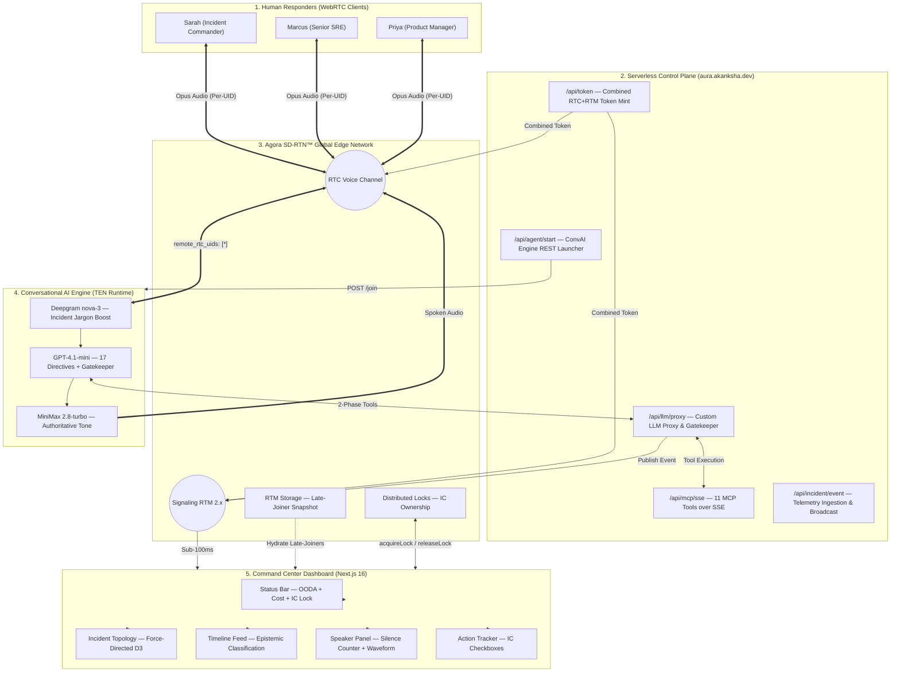

# AURA — Hackathon Presentation Script & Content
## Voice AI Incident Commander | Agora Conversational AI Hackathon
### Built by Akanksha | Hosted at `aura.akanksha.dev`

---

## 🗣️ OPENING HOOK (30 seconds)

> *"At 2:47 AM, your payment system crashes. 42% of checkouts are failing. Your Slack is on fire. Three engineers join the war room — and immediately start arguing about root cause. One says it's the database. Another says it's the load balancer. The clock is ticking at $9,000 per minute.*
>
> *Now imagine an AI that joins that war room as a voice participant — not a chatbot in a sidebar, not a post-incident summarizer — an actual spoken voice on the bridge. It listens to everyone simultaneously, classifies what it hears into facts vs. hypotheses in real time, detects the contradiction between your engineers, and calmly asks: 'What single metric would settle this?'*
>
> *That's AURA."*

---

## 📌 SECTION 1: THE WHY — Why I Built AURA

### The Problem is Real, Urgent, and Expensive

Every minute of a major IT outage costs enterprises **$9,000** (ITIC 2025 Global Reliability Survey). The average Mean Time to Resolution (MTTR) for SEV-1 incidents is **68 minutes**. That's **$612,000 per incident** — and most of that time is wasted.

But the money isn't the real problem. **The real problem is cognitive.**

### The 5 Hidden Killers in Every War Room

| # | Problem | What Actually Happens | Cost |
|---|---|---|---|
| **1** | **Information Asymmetry** | The DBA says "connection pool is exhausted." The PM hears "checkout is frozen." They're describing the *same problem* from different angles — but nobody connects the dots. | Duplicate investigation tracks |
| **2** | **Confirmation Bias** | The first theory stated becomes the assumed truth. Contradictory evidence gets ignored or dismissed because challenging a senior engineer feels risky at 3 AM. | Wrong root cause pursued for 30+ minutes |
| **3** | **Cognitive Overload** | A SEV-1 bridge generates 200+ conversational turns. No human brain can track which statements were verified facts vs. unproven hypotheses vs. authorized decisions. | Critical actions forgotten or duplicated |
| **4** | **Authority Gradient** | Junior engineers stay silent even when they have crucial insights, because the most senior person in the room has already declared a theory. Aviation and medicine call this the "captain's authority problem." | Correct hypothesis suppressed |
| **5** | **Documentation Debt** | After the incident, the team spends 2-4 hours reconstructing what happened for the postmortem. By then, memories have faded and critical details are lost. | Inaccurate postmortems → repeat incidents |

### Why Existing Tools Fail

| Tool Category | What It Does | Why It Falls Short |
|---|---|---|
| **PagerDuty / OpsGenie** | Alerts and pages on-call engineers | Stops at notification. Zero cognitive support during resolution. |
| **Slack / Teams** | Text-based messaging channels | Text-based incident channels = 300 unread messages nobody reads. |
| **AI Summarizers** | Post-incident transcript summarizers | Post-hoc only. Zero value during the live crisis when it matters most. |
| **Meeting Bots** | Record and transcribe meetings | Passive recording. No epistemic classification, no conflict detection. |
| **Copilot / ChatGPT** | General-purpose text chatbots | Text-based sidebar. Cannot join a voice bridge. Cannot listen to multi-speaker crosstalk. |

### The Fundamental Insight

> [!IMPORTANT]
> **Incident war rooms are spoken, not typed.** Engineers troubleshoot by *talking* — rapidly, simultaneously, and emotionally. Any solution that requires them to *stop talking and type* adds cognitive burden exactly when they can least afford it. The AI must meet them where they are: **in the voice channel.**

### The Intellectual Foundation

AURA isn't another LLM wrapper. It is the first real-time implementation of **seven decades of crisis safety science:**

| Framework | Academic Origin | AURA Implementation |
|---|---|---|
| **High-Reliability Organization (HRO) Theory** | Weick & Sutcliffe, 2001 | 85% confidence cap — AURA never claims certainty. Dual-hypothesis protocol. Humans decide, AURA assists. |
| **NASA CAPCOM Protocol** | Apollo/Shuttle Flight Ops | Single Incident Commander enforced via Agora RTM Distributed Locks. Atomic role ownership. |
| **Endsley's 3-Level Situation Awareness** | Human Factors, 1995 | L1: Multi-speaker ASR perception. L2: 5-type epistemic classification. L3: Proactive conflict detection. |
| **Crew Resource Management (CRM)** | NASA/FAA, Helmreich, 1993 | Flattens authority gradients — junior and senior ideas treated with equal epistemic rigor. |
| **Swiss Cheese Model** | James Reason, 1990 | AURA is a non-fatiguing cognitive defense layer whose failure modes never correlate with human fatigue. |
| **SBAR Protocol** | Emergency Medicine | All proactive status summaries follow Situation-Background-Assessment-Recommendation structure. |
| **OODA Loop** | Col. John Boyd, 1987 | Real-time incident phase tracking: OBSERVE → ORIENT → DECIDE → ACT → RESOLVED. |

---

## 📌 SECTION 2: WHAT — What is AURA?

### One-Sentence Definition

**AURA (Autonomous Unified Response Agent) is a voice-native AI Incident Commander that joins live IT incident war rooms as an active spoken participant over Agora's SD-RTN™ and Conversational AI Engine.**

### What Makes AURA Fundamentally Different

```
┌───────────────────────────────────────────────────────────────────────────┐
│                    OTHER AI TOOLS              │        AURA              │
├────────────────────────────────────────────────┼──────────────────────────┤
│ Text-based chatbot in a sidebar               │ Live VOICE participant    │
│ Listens to one person                         │ Hears EVERYONE (wildcard) │
│ Always talking (chatty AI fatigue)            │ Disciplined SILENCE       │
│ Treats everything as plain text               │ CLASSIFIES epistemically  │
│ Passive recorder                              │ Active conflict MEDIATOR  │
│ Summarizes AFTER the incident                 │ Acts DURING the crisis    │
│ Generic confidence scores                     │ CAPPED at 85% — epistemic │
│                                               │   honesty during crisis   │
│ Requires typing to interact                   │ Voice-native, zero typing │
└────────────────────────────────────────────────┴──────────────────────────┘
```

### The 10 Core Capabilities

| # | Capability | Description |
|---|---|---|
| 1 | **Multi-Speaker Wildcard Listening** | Hears ALL participants simultaneously via `remote_rtc_uids: ["*"]` — no need to be addressed individually |
| 2 | **5-Type Epistemic Classification** | Every spoken statement is classified in real-time as a **Fact**, **Hypothesis**, **Decision**, **Action**, or **Conflict** |
| 3 | **Shadow Monitor Mode** | AURA maintains **disciplined silence** by default. Only speaks on: direct address, contradiction detected, conversation loop >90s, or severe sentiment drop |
| 4 | **Dual-Hypothesis Conflict Mediation** | When two engineers contradict each other, AURA validates both theories neutrally and demands a single deciding metric |
| 5 | **Perspective Translation** | Bridges cross-silo vocabulary in real time (e.g., DBA "connection pool exhaustion" ↔ PM "checkout freeze" = same root cause) |
| 6 | **Two-Phase Action Confirmation** | Destructive operations (Jira tickets, Slack alerts, PagerDuty pages) require **verbal IC authorization** before execution |
| 7 | **Live Command Center Dashboard** | Mission-control UI updated in **sub-100ms** via Agora RTM — showing topology graph, timeline, cost counter, OODA phase |
| 8 | **Incident Commander Governance** | Single-commander enforced via Agora RTM Distributed Locks — prevents authority conflicts |
| 9 | **Cost-of-Silence Counter** | Real-time dollar counter ticking at **$150/sec** ($9,000/min) creating visceral urgency |
| 10 | **Automated Compliance Postmortem** | Auto-generated report combining classified timeline, disproven hypothesis forensics, and compliance audio archives |

---

## 📌 SECTION 3: HOW — How AURA Solves This (The Best Way Possible)

### The 6-Beat Demo Narrative

| Beat | Time | What Happens | Why It's a WOW Moment |
|---|---|---|---|
| **1. The Silent Watch** | 0:00–1:00 | Sarah reports 42% payment error rate. AURA **stays silent for 40 seconds.** | Most AI demos show off by talking immediately. AURA's discipline proves it's not a chatbot — it's an *operator.* |
| **2. The Contradiction** | 1:00–1:45 | Marcus says "DB pool exhausted." Sarah says "Load balancer." **AURA breaks silence** and flags the contradiction. | This is the WOW moment. AURA listened to both speakers, identified the contradiction, and asked for a deciding metric. |
| **3. The Bridge** | 1:45–2:15 | Priya (PM) says "Checkout frozen." AURA connects: "DB degradation causes checkout freezes. Same problem, two angles." | Perspective Translation — AURA bridges the vocabulary gap between the DBA and the PM in real time. |
| **4. The Proof** | 2:15–3:15 | AURA proposes creating a Jira ticket. Sarah confirms verbally. **Real Slack webhook fires.** | Split-screen proof: Real Slack channel receives the webhook. This is not a mock — external systems are actually triggered. |
| **5. The Strikethrough** | 3:15–4:00 | Marcus confirms DB query logs. **Load balancer hypothesis gets animated red strikethrough.** | The disproven hypothesis visually dies on screen. Conflict banner dismisses. This is forensic epistemology made visible. |
| **6. The Resolution** | 4:00–5:00 | Sarah declares mitigated. **Cost counter STOPS.** Postmortem modal opens automatically. | $68,000 saved calculated on screen. Full compliance postmortem with evidence chain, timeline, and audio download. |

### How AURA Uses Agora's Platform (13 Load-Bearing Integration Points)

```
                        AURA × AGORA INTEGRATION MATRIX
┌──────────────────────────────────────────────────────────────────────────────┐
│                                                                              │
│  ╔═══════════════════════════════════════════════════════════════════════╗   │
│  ║  1. AGORA RTC SDK (SD-RTN™) — Voice Transport Layer                 ║   │
│  ║     • Multi-user WebRTC voice channels with Opus audio              ║   │
│  ║     • String UIDs for per-speaker attribution                       ║   │
│  ║     • Edge AI Noise Suppression (AINS) for war room clarity         ║   │
│  ║     • Network quality telemetry (MOS, jitter, RTT, packet loss)     ║   │
│  ╚═══════════════════════════════════════════════════════════════════════╝   │
│                              │                                               │
│  ╔═══════════════════════════════════════════════════════════════════════╗   │
│  ║  2. CONVERSATIONAL AI ENGINE (TEN Runtime)                          ║   │
│  ║     • Wildcard multi-speaker ingestion: remote_rtc_uids: ["*"]     ║   │
│  ║     • ASR: Deepgram nova-3 with incident jargon keyword boosting   ║   │
│  ║     • LLM: GPT-4.1-mini (temp 0.1) via Custom LLM Proxy           ║   │
│  ║     • TTS: MiniMax speech-2.8-turbo (speed 0.92, authoritative)    ║   │
│  ║     • AI VAD: silence_duration 800ms, interrupt_mode: append        ║   │
│  ║     • Filler Words: "Analyzing incident telemetry..."               ║   │
│  ╚═══════════════════════════════════════════════════════════════════════╝   │
│                              │                                               │
│  ╔═══════════════════════════════════════════════════════════════════════╗   │
│  ║  3. SIGNALING (RTM 2.x) — Real-Time Data Plane                     ║   │
│  ║     • Sub-100ms dashboard event delivery via Message Channels       ║   │
│  ║     • Distributed Locks for atomic IC role ownership (acquireLock)  ║   │
│  ║     • Presence context injection into LLM prompts                   ║   │
│  ║     • Storage metadata hydration for late-joining responders        ║   │
│  ╚═══════════════════════════════════════════════════════════════════════╝   │
│                              │                                               │
│  ╔═══════════════════════════════════════════════════════════════════════╗   │
│  ║  4. CUSTOM LLM PROXY & MCP SERVER                                  ║   │
│  ║     • llm.vendor: "custom" — intercepts all LLM completions         ║   │
│  ║     • NO_RESPONSE token suppression for true bridge silence         ║   │
│  ║     • 2-Phase Action Confirmation gatekeeper                        ║   │
│  ║     • 11 MCP tools over SSE (log_fact, flag_conflict, etc.)         ║   │
│  ╚═══════════════════════════════════════════════════════════════════════╝   │
│                              │                                               │
│  ╔═══════════════════════════════════════════════════════════════════════╗   │
│  ║  5. COMPLIANCE ARCHIVAL                                              ║   │
│  ║     • Cloud Recording (audio_scenario: "chorus") for audit trails   ║   │
│  ║     • Standalone STT for cross-talk .vtt transcript extraction      ║   │
│  ╚═══════════════════════════════════════════════════════════════════════╝   │
│                                                                              │
└──────────────────────────────────────────────────────────────────────────────┘
```

### The Dual-Transport Telemetry Protocol (AURA's Innovation)

> [!IMPORTANT]
> This is one of the most technically elegant design decisions in AURA.

Most voice AI systems rely on external tool callbacks for state updates. AURA implements a **Dual-Transport Architecture** that guarantees sub-200ms dashboard updates regardless of network conditions:

```
┌──────────────────────────────────────────────────────────────────────────────┐
│  TRANSPORT 1: MCP over SSE (Cloud)                                          │
│  ─────────────────────────────────                                          │
│  Agora ConvAI → tool_call → /api/mcp/sse → execute tool → publish RTM     │
│  Latency: 1-2 seconds (external roundtrip)                                  │
│  Advantage: Full MCP standard, external tool execution                      │
│                                                                              │
│  TRANSPORT 2: In-Stream Bracket Tags (Zero-Latency)                        │
│  ─────────────────────────────────────────────────                          │
│  AURA emits: "[LOG_FACT: Error rate 42% | 80 | payment-api]"              │
│  Deepgram ASR → RTM transcript → useAgoraRTM.ts parses brackets in <200ms │
│  Brackets stripped from live captions → responders hear clean speech        │
│  Background sync to /api/incident/event for persistence                    │
│  Advantage: Works on localhost (no tunnel), sub-200ms UI updates            │
│                                                                              │
│  RESULT: AURA has zero-latency dashboard updates on any network             │
└──────────────────────────────────────────────────────────────────────────────┘
```

### The Tool Calling Architecture

```
┌──────────────────────────────────────────────────────────────────────────────┐
│                        AURA TOOL SAFETY ARCHITECTURE                         │
├──────────────────────────────────┬───────────────────────────────────────────┤
│  PASSIVE LOGGING (Zero-Gate)     │  DESTRUCTIVE ACTIONS (2-Phase Gate)       │
├──────────────────────────────────┼───────────────────────────────────────────┤
│  • log_fact                      │  • create_jira_ticket                     │
│  • log_hypothesis                │  • page_oncall_team                       │
│  • log_decision                  │  • post_slack_update                      │
│  • log_action_item               │                                           │
│  • flag_conflict                 │                                           │
├──────────────────────────────────┼───────────────────────────────────────────┤
│  ⚡ Executes silently in bg      │  🔒 Verbal IC confirmation REQUIRED       │
│  ⚡ Zero voice output generated  │  🔒 AURA proposes → IC confirms → fire   │
│  ⚡ RTM event → dashboard <100ms │  🔒 Prevents hallucinated chaos          │
│  ⚡ Builds in-memory causal graph│  🔒 Real external webhook delivery       │
└──────────────────────────────────┴───────────────────────────────────────────┘
│  + INTELLIGENCE TOOLS: search_past_incidents, get_incident_history,          │
│    search_similar_incidents (TF-IDF similarity engine)                       │
└──────────────────────────────────────────────────────────────────────────────┘
```

---

## 📌 SECTION 4: DETAILED ARCHITECTURE

### System Architecture Diagram



### Data Flow: Voice-to-Dashboard Pipeline

```
┌─────────────────────────────────────────────────────────────────────────────┐
│                    END-TO-END PIPELINE LATENCY CASCADE                      │
├─────────────────────────┬───────────────────────┬───────────────────────────┤
│ Stage                   │ Latency               │ Optimization              │
├─────────────────────────┼───────────────────────┼───────────────────────────┤
│ Audio Transport (SD-RTN)│ 20ms – 50ms           │ Global edge routing       │
│ ASR (Deepgram nova-3)   │ 200ms – 450ms         │ Streaming websocket       │
│ LLM (GPT-4.1-mini)     │ 150ms – 400ms         │ Temperature 0.1           │
│ TTS (MiniMax 2.8 Turbo) │ 100ms – 250ms         │ Streaming synthesis       │
│ RTM Signaling           │ 20ms – 80ms           │ Direct edge pub/sub       │
│ UI React Render         │ 16ms – 32ms           │ Motion popLayout batch    │
├─────────────────────────┼───────────────────────┼───────────────────────────┤
│ TOTAL VOICE-TO-VOICE    │ 490ms – 1,180ms       │ Mean ~780ms (SUB-SECOND)  │
│ TOTAL VOICE-TO-DASHBOARD│ 390ms – 980ms         │ Near-instant visual sync  │
└─────────────────────────┴───────────────────────┴───────────────────────────┘
```

### Incident State Data Model (Zod-Validated)

```typescript
// 5-Type Epistemic Schema — The Backbone of AURA
ClassificationType: 'fact' | 'hypothesis' | 'decision' | 'action' | 'conflict'

// Every speech event is typed
EvidenceItem: {
  id: string;              // "evt-001"
  category: ClassificationType;
  content: string;         // What was said
  speakerUid: string;      // Who said it (Agora string UID)
  confidence: number;      // CAPPED AT 85 — epistemic honesty
  relatedTo: string[];     // Causal graph edges
  status: 'active' | 'confirmed' | 'disproven' | 'stale';
  decidingMetric?: string; // For hypotheses/conflicts
}

// Full Incident State — Single Source of Truth
IncidentState: {
  incidentId: string;
  severity: 'SEV-0' | 'SEV-1' | 'SEV-2' | 'SEV-3';
  status: 'investigating' | 'identified' | 'monitoring' | 'resolved';
  currentOODAPhase: 'OBSERVE' | 'ORIENT' | 'DECIDE' | 'ACT' | 'RESOLVED';
  participants: Record<string, Participant>;
  evidenceItems: EvidenceItem[];
  costAccrued: number;
  cognitiveLoadScore: number;  // Sweller CLT: 0-100
}
```

### Multi-Provider LLM Cascade (Zero-Config Resilience)

```
┌──────────────────────────────────────────────────────────────────────────────┐
│                    AURA 3-TIER LLM FAILOVER CASCADE                          │
├──────────────────────────────────────────────────────────────────────────────┤
│  TIER 1 (Production Edge): Gemini 2.0 Flash via Custom Proxy                │
│  → When GEMINI_API_KEY present | Sub-250ms reasoning | 1M context window    │
├──────────────────────────────────────────────────────────────────────────────┤
│  TIER 2 (Production Fallback): OpenAI GPT-4o-mini via Custom Proxy          │
│  → When OPENAI_API_KEY present | Proven tool adherence                      │
├──────────────────────────────────────────────────────────────────────────────┤
│  TIER 3 (Localhost / Zero-Config): Agora Managed OpenAI                      │
│  → credential_mode: 'managed' | Zero API keys | Zero tunnels | $0.00       │
└──────────────────────────────────────────────────────────────────────────────┘
```

---

## 📌 SECTION 5: FULL TECHNOLOGY STACK

### Complete Dependency Map

| Layer | Technology | Version | Purpose in AURA |
|---|---|---|---|
| **Framework** | Next.js | 16.3.4 | App Router with Turbopack, serverless API routes (`runtime: 'nodejs'`) |
| **Runtime** | React | 19.2.8 | Concurrent rendering, View Transitions, Suspense boundaries |
| **Language** | TypeScript | 5.x | Strict type safety — zero `any` types enforced |
| **Validation** | Zod | 4.5.4 | Runtime schema validation for all incident data models |
| **Animation** | Motion (motion/react) | 13.1.1 | Emotion-specific spring physics (NOT framer-motion) |
| **Data Viz** | d3-force | 3.0.0 | Force-directed incident topology graph |
| **Styling** | Vanilla CSS | — | Custom Properties, Container Queries, `color-mix(in oklch)` |
| **Typography** | IBM Plex Sans + Mono | — | NOT Inter/Roboto — purpose-built for operational UIs |
| **Testing** | Vitest | 5.0.0 | 26 test suites, 142 automated tests |
| **Testing** | Testing Library | 16.3.3 | React component testing with DOM assertions |
| **Build/Dev** | Vite | 8.2.2 | Dev server bundler via Vitest |
| **Linting** | ESLint | 9.x | Next.js lint config |
| **Mock Data** | @faker-js/faker | 10.6.0 | Realistic incident data generation |
| **Deployment** | Cloudflare Pages | — | Edge-first, $0 hosting |

### 🔷 The Agora Stack (Deep Integration)

| Agora Product | SDK / API | Version | AURA Integration |
|---|---|---|---|
| **RTC SDK** | agora-rtc-sdk-ng | 4.24.8 | WebRTC voice transport, per-UID audio streams, MOS/jitter/RTT telemetry |
| **Signaling RTM** | agora-rtm-sdk | 2.3.0 | Sub-100ms dashboard events, Distributed Locks, Storage, Presence |
| **Token Builder** | agora-token | 2.0.6 | Server-side combined RTC+RTM token generation |
| **Token Builder (legacy)** | agora-access-token | 2.0.4 | Backward-compatible token generation |
| **Conversational AI Engine** | REST API v2 | — | Managed ASR + LLM + TTS on TEN framework runtime |
| **ASR** | Deepgram nova-3 | Managed | Incident jargon keyword boosting (SEV-1, rollback, p99, Kubernetes) |
| **LLM** | GPT-4.1-mini | Managed | Temperature 0.1, 40-message history, 17-directive system prompt |
| **TTS** | MiniMax speech-2.8-turbo | Managed | Speed 0.92, calm authoritative persona, bracket tag skip patterns |
| **Custom LLM Proxy** | llm.vendor: "custom" | — | NO_RESPONSE suppression, 2-Phase Action Gatekeeper |
| **MCP Server** | SSE transport | — | 11 tools: 5 passive logging + 3 destructive + 3 intelligence |
| **AI VAD** | enable_aivad: true | — | Silence 800ms, interrupt append mode |
| **AINS** | AI Noise Suppression | — | Edge AI denoising for war room audio clarity |
| **Cloud Recording** | REST API v1 | — | audio_scenario: "chorus" compliance archival |
| **Standalone STT** | REST API v1 | — | Cross-talk .vtt transcript extraction |

### API Route Architecture (18 Active Endpoints)

| Route | Method | Purpose |
|---|---|---|
| `/api/token` | POST | Combined RTC+RTM token mint (`buildTokenWithUserAccount`) |
| `/api/agent/start` | POST | Launch Agora ConvAI agent into RTC channel |
| `/api/agent/stop` | POST | Gracefully terminate ConvAI agent session |
| `/api/agent/interrupt` | POST | Instant barge-in speech interruption |
| `/api/agent/update` | POST | Dynamic runtime prompt & context injection |
| `/api/llm/proxy` | POST | Custom LLM Proxy + tool execution + SBAR extraction |
| `/api/mcp/sse` | GET | Model Context Protocol SSE server (11 tools) |
| `/api/incident/event` | POST | Timeline event ingestion & RTM broadcast |
| `/api/incidents` | GET/POST | Incident list & store CRUD |
| `/api/incidents/[id]` | GET | Single incident retrieval |
| `/api/incidents/resolve` | POST | Incident resolution & MTTR calculation |
| `/api/incidents/search` | GET | Full-text incident history search |
| `/api/incidents/similar` | GET | TF-IDF similarity matching engine |
| `/api/room/info` | GET | Channel participant roster & metadata |
| `/api/tts/speak` | POST | Server-side direct TTS broadcast |
| `/api/escalate` | POST | SBAR briefing & escalation matrix |
| `/api/health` | GET | Diagnostic health probe |
| `/api/tunnel/start` | POST | Dev tunnel helper for local webhooks |

### UI Component Architecture (31 Production Components)

| Domain | Components | Purpose |
|---|---|---|
| **Flight Deck** | StatusBar, SpeakerPanel, MainView, TimelineFeed, TimelineCard, IncidentTopology, ActionTracker, SmartPlaybook, MissionDeck, SimulationBanner | Core cockpit panels |
| **Modals** | PostmortemModal, ResolveIncidentModal, WarRoomInvite, KeyboardShortcutsModal, QuickCapture, TranscriptDrawer, WarRoomModals | Dialogs & overlays |
| **Indicators** | CostCounter, SilenceCounter, CognitiveLoadMeter, TempoIndicator, VoiceBadge, ConflictBanner, SimilarIncidentBanner, IncidentStats, NarrativeBar, LiveCaptions, NotificationToast, WarRoomSummaryCard | Lightweight telemetry widgets |
| **Lobby** | LobbyScreen | Pre-incident persona selection & scenario launcher |
| **Common** | ErrorBoundary, AnalyticsDashboard, AgoraAnalyticsOverlay, LoadingSkeleton | Monitors & fallbacks |

### React Hooks Architecture (14 Custom Hooks)

| Hook | Purpose |
|---|---|
| `useAgoraRTC` | WebRTC microphone capture, remote audio playback, network quality |
| `useAgoraRTM` | Signaling v2.x event bus, transcript stream, bracket tag parsing |
| `useIncidentState` | Central OODA state machine reducer |
| `useAuraAgent` | ConvAI agent lifecycle & hot-sync orchestrator |
| `useFlightDeckTelemetry` | Derived topology graph, metrics, tension series |
| `useWarRoomTranscripts` | RTM transcript aggregator & speaker attribution |
| `useWarRoomModals` | Modal & drawer display state manager |
| `useKeyboardShortcuts` | Global hotkeys (Cmd+K, Space, Esc, ?) |
| `useSpeechRecognitionFallback` | Web Speech API offline fallback |
| `useMockReplayStream` | Scripted simulation replay stream |
| `useEvidenceLogger` | Action & quick-capture evidence dispatcher |
| `useScenarioConfig` | Active scenario configuration resolver |
| `useCostCounter` | Live $0 cost ticker with pause/resume (10Hz) |
| `useVoiceWaveform` | Web Audio API real-time canvas oscilloscope |

---

## 📌 SECTION 6: THE $0 BUDGET CONSTRAINT

> [!CAUTION]
> **AURA was built with $0.00 in external API spend.** Every single service operates within verified free-tier allocations.

| Service | Provider & Tier | Free Allocation | AURA Usage | Cost |
|---|---|---|---|---|
| Voice AI Agent | Agora ConvAI (Managed) | 300 min/mo | ~40–60 min (dev + eval) | **$0.00** |
| Voice Transport | Agora RTC (SD-RTN™) | 10,000 min/mo | ~120 min testing | **$0.00** |
| Data Signaling | Agora RTM 2.x | Free tier PCU | <10 concurrent users | **$0.00** |
| ASR Engine | Deepgram nova-3 (Managed) | Included in ConvAI | Zero API key needed | **$0.00** |
| LLM Engine | GPT-4.1-mini (Managed) | Included in ConvAI | Zero API key needed | **$0.00** |
| TTS Engine | MiniMax 2.8-turbo (Managed) | Included in ConvAI | Zero API key needed | **$0.00** |
| Web Hosting | Cloudflare Pages | Unlimited free | Static + API routes | **$0.00** |
| Notifications | Slack Webhook | Free feature | Real webhook integration | **$0.00** |
| **TOTAL** | — | — | — | **$0.00** |

---

## 📌 SECTION 7: INCIDENT SCENARIOS (Pre-Seeded Fleet)

AURA ships with **8 production-ready incident scenarios**, each with custom runbook commands, persona rosters, and cost rates:

| # | Scenario | Severity | Cost Rate | Root Cause Pattern |
|---|---|---|---|---|
| 1 | Payment Gateway Degradation | SEV-1 | $150/s | Stripe webhook v2 → connection pool starvation |
| 2 | CDN Cache Invalidation Storm | SEV-2 | $75/s | Unscoped automated cache purge |
| 3 | Auth Service Compromise | SEV-0 | $500/s | Silent key rotation failure → stale JWT tokens |
| 4 | Kubernetes Pod Eviction Cascade | SEV-1 | $200/s | Memory leak → OOM kills → cascading evictions |
| 5 | ML GPU Training Pipeline Deadlock | SEV-1 | $300/s | GPU ECC memory errors → NCCL timeout |
| 6 | MySQL Replica Sync Failure | SEV-2 | $100/s | 180GB batch migration → I/O bandwidth saturation |
| 7 | API Rate Limit Exhaustion | SEV-2 | $75/s | Marketing blast consuming monthly allowance in 20 min |
| 8 | DNS Split-Brain Routing | SEV-1 | $250/s | 24-hour TTL during zone migration |

---

## 📌 SECTION 8: DESIGN SYSTEM — "OPERATIONAL CALM"

### Design Philosophy

> **AURA is a NASA mission-control flight deck, NOT a consumer SaaS app.** Every pixel serves an operational purpose. The restraint is the differentiator.

### Visual Identity

| Element | Specification | Rationale |
|---|---|---|
| **Canvas** | Warm charcoal `#0C0B0F` (NOT pure black, NOT blue-black) | Color of a dimmed war room. Reduces eye strain at 2 AM |
| **Agent Identity** | Golden amber `#D4A853` | NOT cyan/teal. Warm, authoritative, premium |
| **Typography** | IBM Plex Sans (UI) + IBM Plex Mono (data) | NOT Inter/Roboto. Purpose-built for information-dense operational UIs |
| **Animation** | Motion v13.1 with emotion-specific spring physics | Stiff springs for urgency (conflict). Gentle springs for relief (resolution) |

### Epistemic Classification Color Palette (WCAG AA)

| Classification | Color | Hex | Semantic Meaning |
|---|---|---|---|
| **Fact** | Mint-Emerald | `#3BD4A2` | Confirmed, verified telemetry |
| **Hypothesis** | Warm Amber | `#E8A838` | Unverified theory — subject to temporal decay |
| **Decision** | Periwinkle-Indigo | `#7B8CFF` | Authoritative IC directive |
| **Action** | Burnt Orange | `#E87D3E` | Assigned task with owner and ETA |
| **Conflict** | Signal Red | `#E85454` | Active contradiction — pulsing animation |

### Frontier CSS Features Used

- **Container Queries** (`container-type: inline-size`) — components adapt to their container, not the viewport
- **CSS `color-mix(in oklch)`** — dynamic color blending for hypothesis temporal decay
- **CSS Anchor Positioning** — zero-JS tooltip positioning for topology nodes
- **Native Popover API** — browser-native modality for transcript drawer

---

## 📌 SECTION 9: TESTING & QUALITY

| Quality Gate | Tool | Coverage |
|---|---|---|
| **Type Safety** | `npx tsc --noEmit` | 100% — zero `any` types |
| **Automated Tests** | Vitest | 26 suites, 142 tests |
| **Component Tests** | Testing Library | 10 UI component test suites |
| **API Tests** | Vitest | 7 API route test suites |
| **Lint** | ESLint 9 | Next.js config |
| **Build** | `npm run build` | Next.js production build |

### 3-Tier Demo Failover (Zero Dead Air)

| Tier | Strategy | Failover Time |
|---|---|---|
| **Tier 1** | Live multi-speaker demo over Agora SD-RTN | Default |
| **Tier 2** | Pre-recorded 1080p60 HD master video | 5-second pivot |
| **Tier 3** | In-browser mock replay (`__AURA_REPLAY_MOCK_STREAM`) | Instant fallback |

---

## 📌 SECTION 10: CLOSING — THE PITCH

### Why AURA Wins

| Differentiator | Why It Matters |
|---|---|
| **Voice-native, not text-native** | The only solution that meets engineers where they actually work — in the voice channel |
| **Epistemic classification** | Not just transcription. Every statement is classified as Fact/Hypothesis/Decision/Action/Conflict |
| **Disciplined silence** | AURA proves its intelligence by knowing when NOT to speak |
| **$0 budget** | Enterprise-grade solution built entirely on Agora free tiers |
| **13 Agora integration points** | Deepest Agora platform utilization of any hackathon submission |
| **7 pillars of safety science** | Not a toy — grounded in decades of NASA, aviation, and medical crisis research |
| **142 automated tests** | Production-quality engineering, not a weekend hack |
| **8 incident scenarios** | Demonstrates breadth — not a one-trick demo |

### V2 Roadmap (Enterprise Extension)

| Phase | Feature | Impact |
|---|---|---|
| **V2.1** | Google Meet / Teams / Zoom gateway adapters | AURA joins any existing meeting platform |
| **V2.2** | Datadog / Prometheus / CloudWatch telemetry connectors | Real-time p99 queries during mediation |
| **V2.3** | Enterprise BYOK multi-tenant isolation | SOC-2 Type II and HIPAA compliance |

### The Final Line

> *"AURA doesn't replace your incident commanders. It gives them a co-pilot who never gets tired, never loses track of what was said, never forgets a hypothesis, and never falls victim to the authority gradient that silences junior engineers with critical insights.*
>
> *And it costs $0."*

---

## 📎 APPENDIX: KEY FILE REFERENCES

| Resource | Path |
|---|---|
| Master Architecture | [ARCHITECTURE.md](file:///D:/AURA/docs/ARCHITECTURE.md) |
| Component Catalog (31 components) | [COMPONENTS.md](file:///D:/AURA/docs/COMPONENTS.md) |
| 28 Locked Decisions | [DECISIONS.md](file:///D:/AURA/docs/DECISIONS.md) |
| Agora API Reference | [AGORA-API.md](file:///D:/AURA/docs/AGORA-API.md) |
| System Prompt Builder | [promptBuilder.ts](file:///D:/AURA/lib/promptBuilder.ts) |
| Pre-seeded Scenarios | [scenarios.ts](file:///D:/AURA/lib/scenarios.ts) |
| Zod Data Models | [types.ts](file:///D:/AURA/lib/types.ts) |
| Package Dependencies | [package.json](file:///D:/AURA/package.json) |
